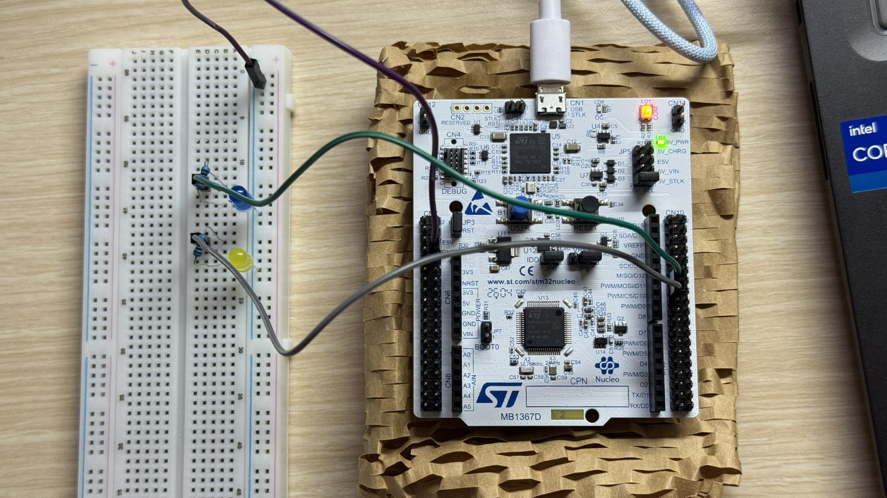
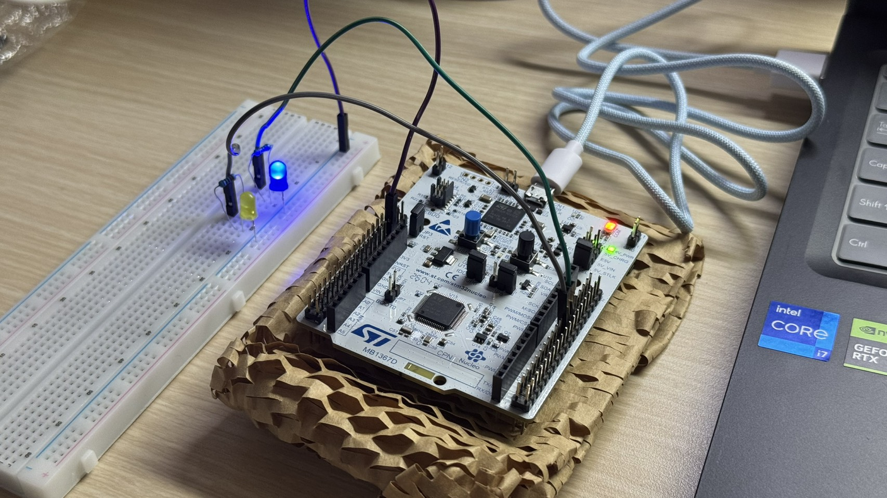
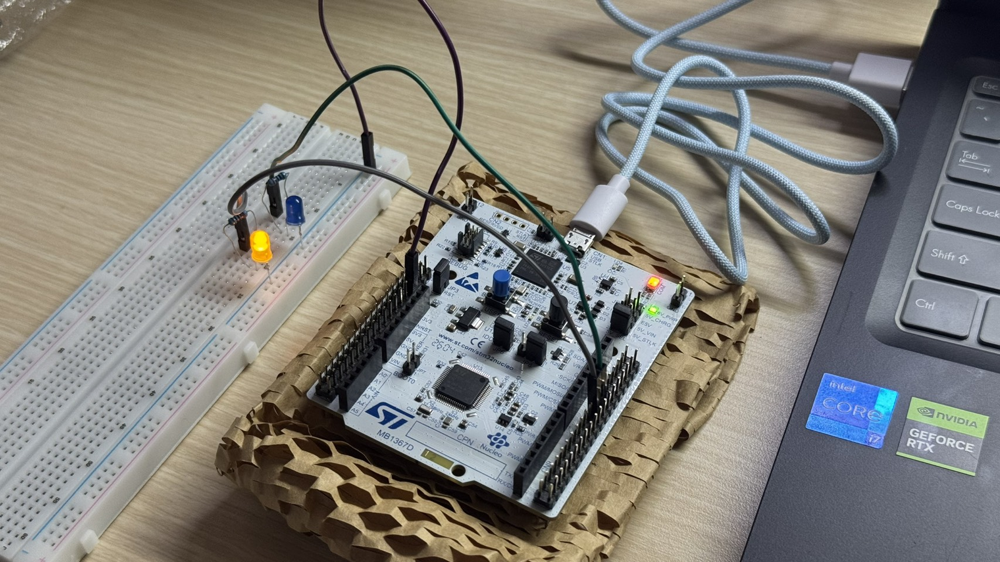

# 智慧讀書專注管理器（STM32G474RE）

> 微算機期中專題｜STM32CubeMX × STM32CubeIDE × C／HAL

本專題使用 STM32G474RE 開發板製作「智慧讀書專注管理器」。使用者可以透過電腦的 UART 終端機輸入希望完成的讀書次數，按下開發板上的 USER 按鈕開始或暫停讀書。系統自動累積完成次數，以藍色 LED 顯示讀書或休息狀態；達成目標後，以黃色 LED 閃爍提示。

## **1. 情境故事：誰、在哪裡、遇到什麼麻煩**

學生在宿舍、家中書桌或圖書館準備考試時，常常因為沒有明確的讀書目標、忘記休息或休息過久，而降低專注效率。如果每次都要拿手機計時，反而可能分心。

因此，我設計一套可以直接在桌面使用的專注管理器：先輸入預計完成幾輪讀書，再透過開發板按鈕操作，並觀察不同顏色的 LED，就能知道目前該專注、休息，或已達成當日目標。

## **2. 替身對照：故事裡的模組 → 板上替身**

| 情境中的角色或裝置 | STM32 專題的替身 |
| --- | --- |
| 讀書者設定今日目標 | 電腦 UART 終端機輸入次數 |
| 開始／暫停按鈕 | 開發板內建 USER 按鈕（GPIO／EXTI） |
| 桌面專注提示燈 | 外接藍色 LED（PA6、TIM3_CH1） |
| 完成目標的獎勵提示燈 | 外接黃色 LED（PA7、TIM3_CH2） |
| 計時器 | HAL 毫秒計時基準 `HAL_GetTick()`（目前測試版） |
| 管理每個階段的流程 | C 語言有限狀態機（FSM） |

## **3. 功能與驗收條件：動作、預期、實測**

| 操作／條件 | 預期結果 | 驗收方式 |
| --- | --- | --- |
| UART 輸入 `2` 並送出換行 | 設定目標為 2 輪 | 終端機顯示 `TARGET SET: 2` |
| 待機時按 USER | 開始第 1 輪讀書 | 藍燈恆亮、終端機顯示 `FOCUS START` |
| 讀書時再按 USER | 暫停讀書計時 | 藍燈熄滅、終端機顯示 `PAUSED` |
| 暫停時再按 USER | 繼續讀書 | 藍燈恢復恆亮、顯示 `RESUMED` |
| 完成 1 輪且未曾暫停 | 休息 10 秒（測試版獎勵） | 藍燈呼吸、顯示 `BONUS REST` |
| 完成 1 輪且曾暫停 | 休息 5 秒（測試版一般休息） | 藍燈呼吸、顯示 `NORMAL REST` |
| 休息結束且未達標 | 自動開始下一輪 | 顯示 `REST FINISHED` 與下一輪 `FOCUS START` |
| 完成指定目標 | 進入完成狀態 | 顯示 `GOAL COMPLETED!`、黃燈閃爍 |
| UART 輸入 `R` | 重設進度，回待機 | 顯示 `SYSTEM RESET`，兩燈熄滅 |

## **4. 用到的技術：第 3～7 週勾選表**

| 技術 | 在本專題的用途 |
| --- | --- |
| GPIO／EXTI／NVIC | 偵測內建 USER 按鈕按下的外部中斷 |
| UART（LPUART1） | 接收目標次數與重設指令、輸出執行訊息 |
| Timer／時間基準 | 計算讀書與休息秒數；目前測試版採用 `HAL_GetTick()` |
| PWM（TIM3） | CH1 控制藍燈亮度及呼吸效果，CH2 控制黃燈閃爍 |
| RCC／Clock Configuration | 設定系統及周邊時鐘 |
| 狀態機（FSM） | 將待機、讀書、暫停、休息、完成五種狀態分開管理 |

## **5. 腳位表：每支腳位的用途**

| 腳位／周邊 | 設定 | 用途 |
| --- | --- | --- |
| PA6 | TIM3_CH1 / PWM | 藍色 LED：讀書恆亮、休息呼吸 |
| PA7 | TIM3_CH2 / PWM | 黃色 LED：達標閃爍 |
| PC13（需核對 `.ioc`） | GPIO_EXTI | 開發板內建 USER 按鈕 |
| LPUART1 的 TX／RX | Asynchronous | UART 與電腦通訊（實際腳位以 `.ioc` 為準） |
| GND | 共地 | LED 電路接地 |

## **6. 建置與執行：開發環境、燒錄步驟、終端機設定、命令**

1. 使用 **STM32CubeMX／STM32CubeIDE** 開啟專案 `.ioc`，確認 PA6、PA7、USER 按鈕、TIM3 和 LPUART1 已依實際電路設定。
2. 在 STM32CubeIDE 編輯 `Core/Src/main.c`；自訂函式、變數與初始化操作放在對應的 `USER CODE BEGIN/END` 區塊內。
3. 按 `Ctrl + S` 儲存，`Ctrl + B` 編譯，確認無編譯錯誤。
4. 透過 ST-LINK 將韌體下載至 STM32 開發板。
5. 開啟可連到 **LPUART1** 的 UART 終端機。若使用程式預設的 `115200` 鮑率，終端機設定為 **115200、8N1、無流量控制**；仍須確認 LPUART1 實際是否有接到 USB-UART 介面。
6. 輸入 `2` 並按 Enter，設定兩輪讀書目標，再按 USER 按鈕啟動。
7. 要重新開始時輸入 `R` 並按 Enter。

**UART 指令表**

| 指令 | 作用 |
| --- | --- |
| `1`～`1000` | 設定要完成的讀書輪數（在待機或完成狀態時設定） |
| `R` 或 `r` | 重設進度並回到待機 |
| USER 按鈕 | 待機→開始；讀書→暫停；暫停→繼續 |

## **7. 程式結構：哪個檔案、ISR 與主迴圈分工**

主要程式位於 `Core/Src/main.c`，CubeMX 另外產生硬體初始化與中斷服務相關檔案。

| 程式或函式 | 功能 |
| --- | --- |
| `main()` | 初始化系統、TIM3 PWM、LPUART1 接收，執行主迴圈 |
| `HAL_GPIO_EXTI_Callback()` | 記錄 USER 按鈕事件，包含基本防彈跳 |
| `HAL_UART_RxCpltCallback()` | 接收 UART 字元；收到換行後標記指令完成 |
| `processButton()` | 切換讀書、暫停與恢復狀態 |
| `processUart()` | 設定目標次數或執行重設 |
| `updateTimer()`／`processSecond()` | 根據經過時間更新秒數、累積完成次數與切換狀態 |
| `startFocus()`／`startBreak()` | 開始新一輪讀書／一般或獎勵休息 |
| `finishGoal()` | 進入 DONE 完成狀態 |
| `blueLed()`／`yellowLed()` | 透過 TIM3 CH1／CH2 控制 LED |
| `updateLeds()` | 執行藍色呼吸燈與黃色達標閃爍效果 |

主迴圈依序處理按鈕事件、UART 命令、時間更新與 LED 更新；中斷回呼只處理必要的事件和資料接收，避免在中斷裡執行整套狀態切換邏輯。

狀態機包含五個狀態：`IDLE`（待機）、`FOCUS`（讀書）、`PAUSE`（暫停）、`BREAK`（休息）、`DONE`（完成）。

## **8. 實作照片：每張附一行圖說**

*圖 1：STM32G474RE 開發板、藍色與黃色 LED、限流電阻及接線方式。*

*圖 2：透過 LPUART1 設定目標輪數並顯示執行進度。*

*圖 3：按下 USER 按鈕後進入 FOCUS 狀態，藍燈恆亮。*

*圖 4：完成一輪讀書後進入 BREAK 狀態，藍燈以 PWM 呈現呼吸效果。*

*圖 5：讀書次數達標後進入 DONE 狀態，黃色 LED 閃爍提醒。*

## **9. AI 使用說明：哪段請 AI、你怎麼查核**

本專題開發過程中使用 ChatGPT 協助整理需求、撰寫和修改部分 C／HAL 程式碼，以及釐清 GPIO／EXTI、UART、PWM、狀態機與時間計算的關係。

實際除錯時，曾遇到以下問題：

- **TIM2／TIM6 不一致：** 原先範例使用 `htim2`，但 CubeMX 專案實際初始化 `htim6`；透過編譯錯誤訊息核對計時器名稱。
- **秒數計算異常：** 原先把 TIM6 中斷次數當成秒數，測試版改為以 `HAL_GetTick()` 比較經過的毫秒數。
- **黃色 LED 不亮：** 原先用一般 GPIO 輸出控制 PA7，後來確認實際設定是 `TIM3_CH2`，因此調整為 PWM Channel 2 控制。

## **10. 已知限制：哪些用替身、換真實裝置要改哪裡**

1. **時間為展示用縮短版：** 目前採 10 秒讀書、5 秒一般休息、10 秒獎勵休息；正式使用需將 `FOCUS_TIME`、`NORMAL_REST`、`BONUS_REST` 分別設為 `3000U`、`600U`、`900U`。
2. **目前計時來源：** 測試版使用 `HAL_GetTick()`，尚未在此版本完成 TIM6 中斷每秒計時的驗證。若課程要求以硬體 Timer 中斷作為主要計時來源，應再依真實時鐘設定 TIM6 Prescaler、ARR 與 NVIC。
3. **UART 連線：** 系統僅接收數字目標及 `R` 重設指令，尚無圖形化操作介面。現有程式使用固定字串緩衝區而非真正環形 Ring Buffer。
4. **目標設定：** 目前只有待機與完成狀態能重新輸入讀書目標；沒有時間表、日期紀錄或斷電保存功能。
5. **硬體替身：** 以兩顆 LED 分別代表專注、休息與達標提示。未來如改用顯示器、蜂鳴器或智慧燈條，須額外修改輸出硬體與驅動程式。

